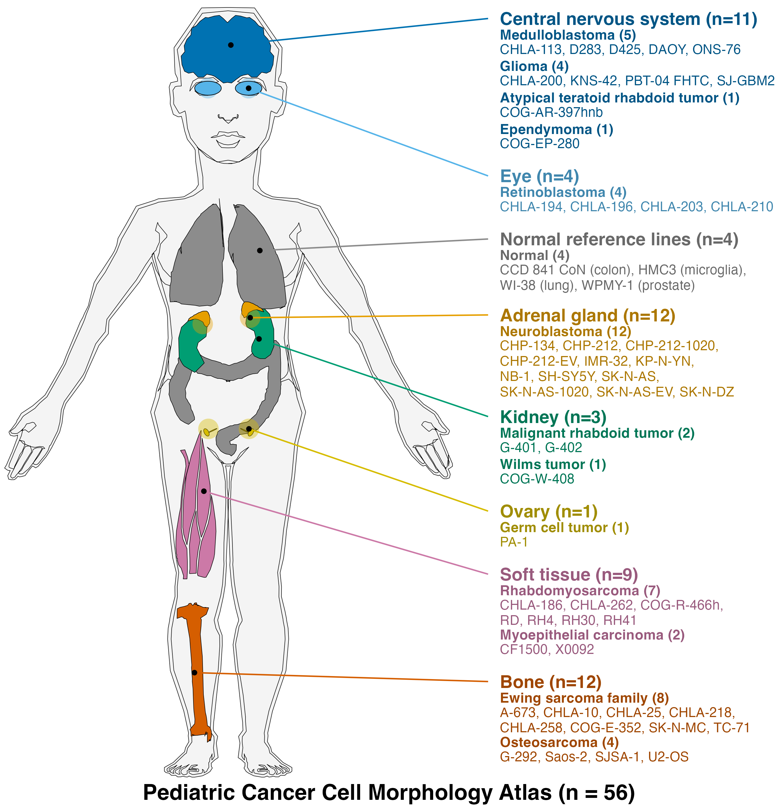
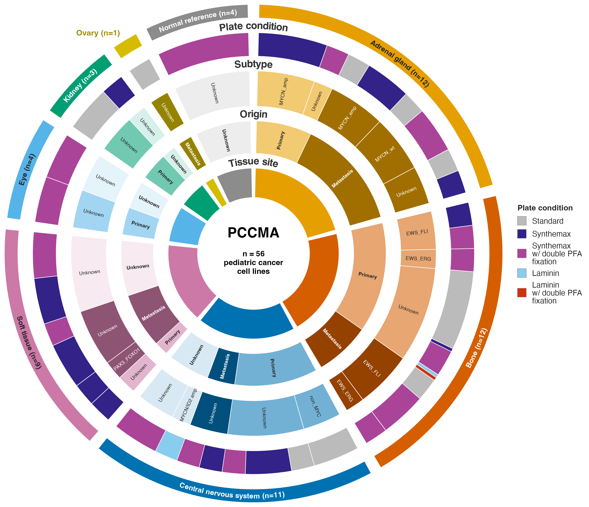
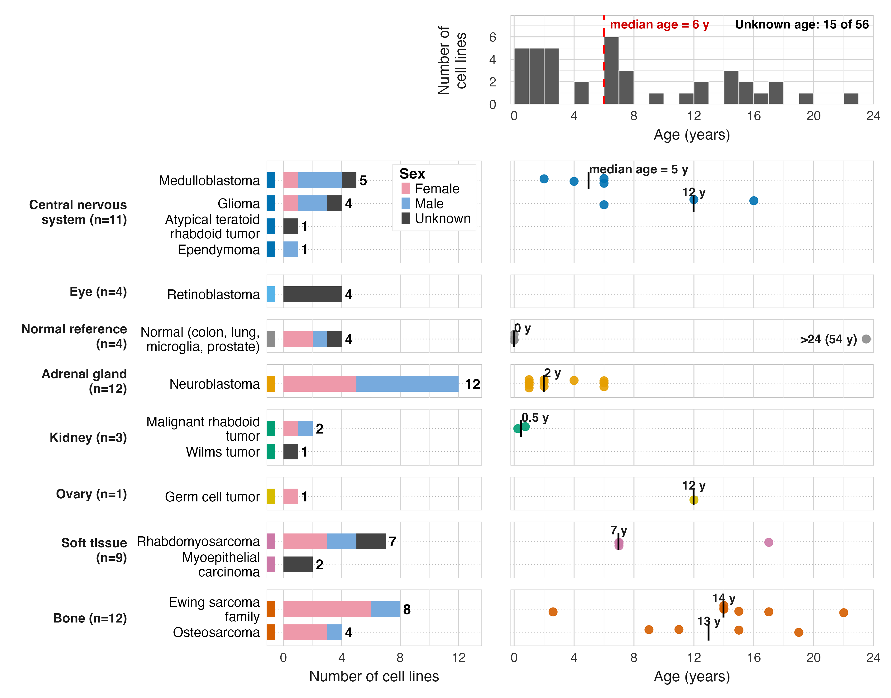

<p align="center">
  <picture>
    <source media="(prefers-color-scheme: dark)" srcset="./logo/pccma_logo_transparent_on_dark.svg">
    
  </picture>
</p>

Image analysis and image-based profiling workflows to extract morphology profiles from the Pediatric Cancer Cell Morphology Atlas (PCCMA) dataset.

## Cell Painting assay

Cell Painting is a multiplexed fluorescence microscopy assay that labels eight cellular components with six dyes in five imaging channels ([Bray et al., 2016](https://www.nature.com/articles/nprot.2016.105)).
We segment the nuclei, cells, and cytoplasm in each field of view and measure each compartment.
These measurements yield a vector of size, shape, intensity, and texture features per cell, which we call a morphological profile.
The table under [Atlas data](#atlas-data) lists the channels and the structures they label.

## Atlas data

The Atlas is a Cell Painting dataset of 56 cell lines that we imaged at three time points (24, 48, and 72 hours).

- **Plates:** Nine 384-well plates, where each plate is one time point.
- **Cell lines:** 56 cell lines are each on one set of three plates (one plate per time point) with four wells per plate.
U2-OS is on all nine plates as a control cell line.
- **Conditions:** We set the seeding density (1,000 to 12,000 cells/well) and plate coating (Standard, Synthemax, or Laminin, with double PFA fixation for some Synthemax and Laminin plates) per cell line and record them in the platemaps.
- **Imaging:** Nine fields of view (FOVs) per well at 20x magnification.
- **Channels:** We use five Cell Painting channels for analysis.
We do not include the brightfield channels.

| Channel name | Stain target | Name in pipelines |
| --- | --- | --- |
| HOECHST 33342 | Nuclei | DNA |
| Alexa 488 | Endoplasmic reticulum | ER |
| Alexa 488 Long | Nucleoli and cytoplasmic RNA | RNA |
| Alexa 568 | Actin, Golgi, and plasma membrane | AGP |
| Alexa 647 | Mitochondria | Mito |

| Plates | Time points | Number of cell lines | Wells with cells per plate |
| --- | --- | --- | --- |
| BR00150695, BR00150696, BR00150697 | 24, 48, 72 hours | 14 | 56 |
| BR00150698, BR00150699, BR00150700 | 24, 48, 72 hours | 19 | 84 |
| BR00150701, BR00150702, BR00150703 | 24, 48, 72 hours | 25 | 108 |

### Empty wells we imaged

We imaged some wells that do not contain cells (media only), so the platemaps (`0.download_data/metadata/platemaps/`) do not include them.
We visually confirmed that these wells are empty.
Because we build the per cell line LoadData CSVs in `3.cp_analysis` from the platemaps, segmentation and feature extraction do not process these wells.

| Plates | Time points | Empty wells imaged | Number of wells |
| --- | --- | --- | --- |
| BR00150695, BR00150696, BR00150697 | 24, 48, 72 hours | Rows C-F in columns 9-10 and rows G-N in columns 7-10 | 40 |
| BR00150698, BR00150699, BR00150700 | 24, 48, 72 hours | Rows I-N in columns 9-10 | 12 |
| BR00150701, BR00150702, BR00150703 | 24, 48, 72 hours | Rows C-H in columns 3-4 | 12 |

## Atlas cell lines

We annotate each cell line with its tissue site, cancer type, subtype, origin, donor sex and age, and plating condition.
The annotations are in [`cell_lines/pccma_cell_line_metadata.csv`](./cell_lines/pccma_cell_line_metadata.csv).

<p align="center">
  
</p>

**Figure 1. Tissue site and cancer type of the 56 atlas cell lines.**
Colored organs mark the typical site of each tumor type, and the text lists each tissue site with its cancer groups and cell lines (n, number of cell lines).
Gray marks the four normal reference lines.

<p align="center">
  
</p>

**Figure 2. Annotation of the atlas cell lines.**
Concentric rings subdivide each tissue site by origin, subtype, and plate condition, and the angle of each wedge is proportional to the number of cell lines.
Light and dark shades of the site color mark primary and metastatic origin.
Unknown marks lines without an annotation.

<p align="center">
  
</p>

**Figure 3. Donor sex and age of the atlas cell lines.**
Left, number of cell lines per cancer group, stacked by donor sex.
Right, donor age of each cell line, with a black tick at the group median.
Top, age distribution of all cell lines with a known age, with the overall median as a dashed red line.
We omit lines without a recorded age, and we draw the prostate line WPMY-1 (54 years) at the right edge of the age axis and exclude it from the histogram.

## Repository structure

The module numbers follow the order in which we run them.

| Module | Purpose |
| --- | --- |
| [0.download_data](./0.download_data/) | Generate the platemap for each plate from the experimental layout file and create platemap figures. |
| [1.whole_image_qc](./1.whole_image_qc/) | Extract whole image quality metrics with CellProfiler and determine the blur and saturation thresholds that identify poor quality FOVs. |
| [2.illumination_correction](./2.illumination_correction/) | Calculate an illumination correction function per channel for each plate with CellProfiler. |
| [3.cp_analysis](./3.cp_analysis/) | Perform illumination correction, segmentation, and feature extraction with CellProfiler, where each cell line has its own pipeline. |
| [5.morphem_featurization](./5.morphem_featurization/) | Extract nucleocentric deep learning features with MorphEm using the nuclei from CellProfiler, and process them into single-cell and bulk profiles. |
| [cell_lines](./cell_lines/) | Build the consolidated cell line metadata table and create the descriptive figures of the cell lines. |
| [environments](./environments/) | Conda environment files and a script to create the environments on an HPC cluster. |
| [utils](./utils/) | Shared functions for creating LoadData CSVs, running CellProfiler in parallel, loading the single cells that passed QC, and extracting MorphEm features. The uv environments install it as a package in editable mode (`pccma-atlas-utils`), so notebooks import it without changing `sys.path`. |

## Quality control (QC) of poor quality images

We handle poor quality FOVs (blurry or over-saturated) differently depending on the module:

- **Illumination correction:** We filtered out poor quality FOVs prior to calculation of the illumination correction functions to avoid issues in the output.
- **Segmentation and feature extraction:** We do process poor quality FOVs.
We apply QC later on, which allows us to salvage any good cells from these FOVs.

## Running the analysis

Each module contains notebooks and a bash script that converts the notebooks to Python scripts and runs them.

### Environments

Create the environments from the files in the `environments` folder.
The CellProfiler modules (whole image QC metric extraction, illumination correction, and analysis) use `pccma_atlas_cp_env`.

We are moving the Python environments from conda to [uv](https://docs.astral.sh/uv/).
Each uv environment is a folder in `environments` with a `pyproject.toml` and a `uv.lock` file that pins every package:

| uv environment | Modules |
| --- | --- |
| `environments/preprocessing` | `4.preprocess_features` and processing the MorphEm profiles in `5.morphem_featurization` |
| `environments/morphem` | Extracting the MorphEm features in `5.morphem_featurization` (PyTorch with CUDA) |

The bash scripts of these modules create or update the environments for you.
To create one yourself (e.g., to select it as the kernel for the notebooks):

```bash
# creates environments/preprocessing/.venv with the versions in uv.lock
uv sync --locked --project environments/preprocessing
```

```bash
# create one environment
conda env create -f environments/cellprofiler_env.yml
```

On an HPC cluster with SLURM, you can create the environments with the provided script from within the `environments` folder:

```bash
cd environments
# create all environments
sbatch hpc_create_envs.sh
# or create only the CellProfiler environment
sbatch hpc_create_envs.sh cellprofiler_env.yml
```

### Segmentation and feature extraction

The `3.cp_analysis` module processes each cell line from each plate (time point) as its own job.
There are 174 cell line and plate combinations (55 cell lines on three plates and U2-OS on nine plates), and we process 166 of them.
The [module README](./3.cp_analysis/README.md) lists the cell lines and time points that we do not process.
Each job outputs a SQLite file to `3.cp_analysis/sqlite_outputs/<plate>_<cell_line>/`.

To run on an HPC cluster with SLURM, submit the parent script from within the module, which creates the LoadData CSVs and submits one job per cell line per plate:

```bash
cd 3.cp_analysis
sbatch cp_analysis_hpc_parent.sh
```

To run on a local machine:

```bash
cd 3.cp_analysis
source cp_analysis_local.sh
```

> **Note:** `3.cp_analysis/0.create_loaddata_csvs.ipynb` sets the path to the images for both the HPC cluster and a local machine, so update it to where you store the images.
